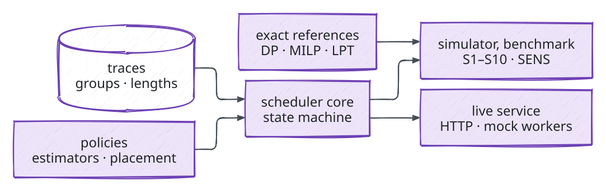
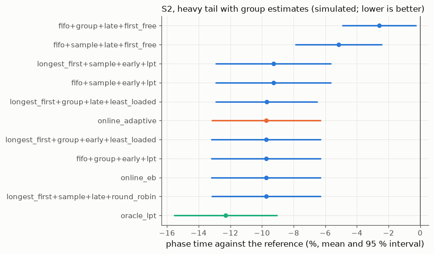

<p align="center"></p>

<p align="center">
<a href="https://github.com/AKASB1/rollout-engine/actions/workflows/ci.yml"></a>
<a href="LICENSE"></a>


</p>

# RL Post-Training Rollout Engine

A deterministic simulator of the rollout side of RL post-training, a benchmark of scheduling policies, and a live service that runs the same policies on mock workers.

<p align="center"><a href="#highlights">Highlights</a> · <a href="#quick-start">Quick start</a> · <a href="#results">Results</a> · <a href="#documentation">Documentation</a> · <a href="#limitations">Limitations</a></p>

> **Simulated.** Every scheduling result here comes from a discrete-event simulation with assumed parameters ([docs/simulator.md](docs/simulator.md)); the only measured numbers are wall-clock timings of this code.

In RL post-training, a trainer waits for rollout workers to generate groups of samples, and response lengths are heavy-tailed and unknown in advance. A few long samples can leave most workers idle while the trainer waits. This project models that loop to compare scheduling policies. Prompts arrive as groups of samples (as in GRPO), workers batch at the iteration level or statically, and a verifier pool checks samples. The trainer consumes batches of groups and publishes new weights, and a staleness bound limits how old the weights behind a consumed sample may be. Policies decide which groups to launch, where to place their samples, which stragglers to drop, and which sample a free verifier takes next. The trainer and the inference engines stay outside the repository: they are modeled, not run.

<p align="center"></p>

## Highlights

The benchmark runs scenarios S1 to S10 on the simulator. S2 times one rollout phase on the continuous engine; S3 and S4 run the closed loop of rollout and training steps. The reference policy is the even static split of a batch across workers. The best S2 policy (`longest_first+sample+late+least_loaded`) has the lowest tuned J in S2, and the closed-loop scenarios reuse its parts. `eta` is the staleness bound: a group whose weights are more than `eta` versions behind the trainer's next step is dropped. `wait` keeps at most `B` groups outstanding, one training batch. `carry(rho)` keeps up to `rho × B` and lets the unselected groups run on into later steps; `abort(rho)` drops them after each selection. Waste is the share of generated tokens that belong to dropped groups. Length bias is the mean length of the consumed groups' samples relative to that of consumed and dropped groups, minus 1.

- **Ordering by estimated length shortens the phase.** With group-level length estimates and a heavy tail, ordering work by estimated length shortens one phase by 9.7 % against the reference (19 wins, 1 loss over 20 seeds). Either launching the longest groups first or assigning by LPT (longest processing time first) does it ([S2](benchmarks/README.md#findings-in-detail)).
- **A better phase policy shortens the closed loop.** At `eta = 1`, the best S2 policy with `wait` cuts the mean step time from 101.2 s to 84.9 s ([S3](benchmarks/README.md#findings-in-detail)).
- **Carrying stragglers is cheap once the bound allows it.** At `eta = 2`, `carry(2)` reaches 47.9 s with 2 % waste, against 62.2 s with 36 % waste for `abort(1.5)` ([S4](benchmarks/README.md#findings-in-detail)).
- **At a tight bound, carrying wastes a third of the tokens.** At `eta = 1`, `carry(1.25)` brings the step to 60.6 s. But 31 % of the generated tokens then belong to groups that go stale, and the consumed lengths are biased by −23 % ([S3](benchmarks/README.md#findings-in-detail)).
- **Static batching against the exact optimum.** On 50 small instances (8–16 samples on 2–3 workers), the dynamic program `dp` ends 6.3 % above the MILP optimum on average. `sorted_chunk` ends 6.6 % above and `fifo_chunk` 12.1 % ([S7](benchmarks/README.md#findings-in-detail)).
- **Scenario planning narrows the spread of static plans.** On the 50 evaluation instances, a plan made on point estimates ends 5.0–35.0 % above the clairvoyant optimum (the best plan on the true lengths) on average. Where in that range it ends depends on which optimal plan the solver returns. The plan that minimizes the expected makespan over sampled length scenarios (`lam = 0`) ends 3.3–4.1 % above on average. Even its worst optimal plan is within noise of the most favorable point-estimate plan, which only the true lengths identify (0.9 ± 3.1 percentage points) ([S9](benchmarks/README.md#findings-in-detail)).

## Features

- Simulator: a continuous engine (iteration-level batching with KV reservations, prefix sharing, prefill pauses) in closed form, checked against a step-by-step reference on 2100 random scenarios. It also has a static engine, a verifier pool, a trainer, staleness rules, and disaggregated and colocated partitions ([docs/simulator.md](docs/simulator.md)).
- Traces: schema v1 with a loader that names the line of every error, manifests with SHA-256, and a generator with heavy-tailed group lengths and estimates ([docs/contracts.md](docs/contracts.md)).
- Policies: estimators, launch order, group or sample dispatch, early or late binding, assignment, static batch formation, straggler rules, deadline-aware admission, and verifier order.
- Exact references: a dynamic program over sorted lengths, a makespan MILP (SciPy and HiGHS), LPT with Graham's bounds, and a scenario MILP with CVaR ([docs/optimization.md](docs/optimization.md)).
- Benchmark: scenarios S1 to S10 and SENS, equal-budget tuning on disjoint seeds, paired statistics, manifests ([benchmarks/README.md](benchmarks/README.md)).
- Live service: an asyncio controller on the same core state machine, an HTTP JSON API, a sqlite3 store, mock workers, and Prometheus metrics. On a virtual-time loop it reproduces the simulator exactly ([docs/service.md](docs/service.md)).

The simulator and the live controller drive one core state machine ([docs/architecture.md](docs/architecture.md)).

## Installation

You need Python 3.12. Create the environment once. In Windows PowerShell:

```powershell
powershell -ExecutionPolicy Bypass -File scripts\setup_env.ps1
.venv\Scripts\Activate.ps1
```

On Linux or macOS (bash):

```bash
bash scripts/setup_env.sh
source .venv/bin/activate
```

In Git Bash on Windows, activate with `source .venv/Scripts/activate`. If PowerShell refuses `Activate.ps1`, call `.venv\Scripts\python.exe` instead of `python` below. Run the shell scripts through `bash`, or run `chmod +x scripts/*.sh` once.

## Quick start

Run the tests, the quick benchmark, and the demo, with the same commands in both shells, from the repository root:

```bash
python -m pytest -q
python -m rollout_engine.bench --quick --workers 4
python -m rollout_engine.service.demo --port 18300
```

`--workers` sets the number of parallel simulation processes (default: half the logical processors). The demo starts the service on `127.0.0.1:18300`, attaches mock workers, verifiers, and a trainer over HTTP, consumes three training batches, prints them, and exits. `bash scripts/verify.sh` or `powershell -ExecutionPolicy Bypass -File scripts\verify.ps1` runs all three.

Run the full evaluation and draw the figures:

```bash
python -m rollout_engine.bench --workers 4
python -m rollout_engine.bench microbench
python scripts/s9_tie_ranges.py --workers 4
python scripts/plot_results.py
python scripts/plot_timeline.py
```

## Configuration

| Input | Location | Contents |
|---|---|---|
| experiments | `configs/experiments.json` | scenarios, seeds, grids |
| tuned parameters | `configs/tuned/tuned.json`, `s7_tuning.csv`, `s9_tuning.csv` | the frozen tuning results |
| sample trace | `configs/traces/sample.csv` with its manifest | a small trace in schema v1 |
| formats | [docs/contracts.md](docs/contracts.md) | trace schema v1, system configuration v1, the objective J |

## Results

The default system has 8 rollout and 8 training GPUs of an 80 GB class and a 7.6 B model. The trainer consumes `B = 64` groups of 8 samples per step, and lengths are heavy-tailed with group estimates ([docs/simulator.md](docs/simulator.md)). The evaluation ran 20 evaluation seeds (10 for SENS) on commit `0855d05` of the development history, which is not published; the manifests record it. The tuned configuration was committed before it. Results go to `benchmarks/results/full/`, with manifests and SHA-256.



*S2 in the default cell, heavy tail with group estimates. Each row is one launch order, dispatch, and binding with the assignment that had the shortest mean phase on the evaluation seeds, picked after the fact. The tuned best S2 policy (`…+least_loaded`) has the same 70.9 s mean as the `round_robin` row shown. The online estimators and the oracle are included. The full figure with every policy and three more cells is on the [results page](benchmarks/README.md#results).*

The closed loop (S3 and S4 cells) is compared on J ([docs/contracts.md](docs/contracts.md) section 4). J weighs step time, GPU idle time, the P95 straggler delay, waste, and |length bias|, with weights fixed before the evaluation; lower is better.

| Policy | J | step time (s) | waste | length bias | W/T/L |
|---|---|---|---|---|---|
| reference, `eta = 1` | 1.461 ± 0.039 | 101.2 ± 2.4 | 0 % | 0 % | – |
| best S2 + `wait`, `eta = 1` | 1.169 ± 0.025 | 84.9 ± 1.3 | 0 % | 0 % | 20/0/0 |
| best S2 + `carry(1.25)`, `eta = 1` | 1.364 ± 0.014 | 60.6 ± 0.9 | 31 % | −23 % | 17/2/1 |
| best S2 + `carry(2)`, `eta = 2` | 0.673 ± 0.007 | 47.9 ± 0.5 | 2 % | −1 % | 20/0/0 |
| best S2 + `abort(1.5)`, `eta = 2` | 1.458 ± 0.010 | 62.2 ± 0.7 | 36 % | −25 % | 8/3/9 |

W/T/L counts the seeds on which a policy wins, ties, or loses against the reference on J (tie band 1 %). The table with every term of J, the other scenarios, and the figures are on the [results page](benchmarks/README.md#results).

## Evaluation protocol

- Tuning seeds (1000–1009) are disjoint from the evaluation seeds (1–20, 10 for SENS), and every policy gets the same tuning budget.
- The tuned configuration was committed before the reported evaluation. An earlier evaluation exposed a flaw in the tuning procedure, which was fixed.
- The number of tuning seeds and one single-phase weight were revised after the previous evaluation's results had been seen; the [protocol](benchmarks/README.md#protocol) records both changes.
- Means carry 95 % Student-t intervals across seeds. Paired differences against the reference give wins, ties, and losses, with a 1 % tie band.
- The accounting identities and the staleness invariants are checked on every simulated run.

## Documentation

| Guide | Covers |
|---|---|
| [docs/architecture.md](docs/architecture.md) | the core state machine and its two drivers |
| [docs/contracts.md](docs/contracts.md) | formats, configuration, policy parts, the objective J |
| [docs/simulator.md](docs/simulator.md) | the model and its assumed parameters |
| [docs/optimization.md](docs/optimization.md) | the exact references for static batching |
| [docs/service.md](docs/service.md) | the live service |
| [benchmarks/README.md](benchmarks/README.md) | protocol, scenarios, every result, and the limitations |

[IMPLEMENTATION.md](IMPLEMENTATION.md) describes the main boundary and the delivery order, and [CONTRIBUTING.md](CONTRIBUTING.md) the development checks.

## Project layout

```text
src/rollout_engine/
  api/         records and actions shared by every layer
  trace/       trace schema v1 and the generator
  workers/     rollout engines (closed form) and step-by-step references
  batching/    static batch cost model
  verifier/    verifier pool
  scheduler/   the core state machine and the read-only view
  policies/    policy parts, presets, the empirical-Bayes estimator, the factory
  sim/         discrete-event driver, accounting and staleness checkers
  telemetry/   metrics and Prometheus text
  opt/         DP, MILP, LPT, brute force, bounds, scenario MILP, S7/S9
  bench/       experiments, runner, tuning, statistics, CLI
  service/     controller, HTTP, virtual-time loop, mock components, demo
  storage/     sqlite3 store and trace export
configs/       experiments, tuned parameters, sample trace
docs/          contracts, simulator, optimization, service, architecture, figures, diagram source, icon
benchmarks/    protocol and committed results
scripts/       figures, setup and verify scripts, solver cross-check, diagram, icon
tests/         checks 1-10 and unit tests
```

## Testing

`python -m pytest -q` checks the closed-form engine against the step-by-step reference and the verifier pool against Pollaczek–Khinchine, Erlang C, and the Lindley recursion. It also checks the accounting identities and that the live service reproduces the simulator on a virtual-time loop. CI runs the ruff lint and format checks, the tests, the quick benchmark, and the demo.

## Limitations

- Every scheduling result is simulated with assumed parameters; nothing is fitted to a GPU measurement.
- All response lengths are synthetic; no public dataset of responses is resampled.
- Staleness and length bias are measured quantities; their effect on learning is not modeled.
- The service's wall-clock load test has not been run on a committed state, and no real-engine adapter exists.

Further limitations: [benchmarks/README.md](benchmarks/README.md#limitations).

## Related projects

- [OpenRLHF/OpenRLHF](https://github.com/OpenRLHF/OpenRLHF): distributed RLHF and RL training built on Ray and vLLM, with agent-based rollouts. This project simulates the scheduling of the rollout and training loop and trains nothing.
- [verl-project/verl](https://github.com/verl-project/verl): RL post-training for LLMs that combines FSDP or Megatron training with vLLM or SGLang rollout. This project compares rollout-scheduling policies in a simulator and a mock-worker service.
- [THUDM/slime](https://github.com/THUDM/slime): RL scaling that connects Megatron training with SGLang rollout through a data buffer. This project is a simulator and a mock-worker service of smaller scope.
- [inclusionAI/AReaL](https://github.com/inclusionAI/AReaL): asynchronous RL that decouples generation from training under a staleness bound. This project measures staleness and length bias as quantities in a simulation.

## License and acknowledgments

MIT, see [LICENSE](LICENSE). The stack: NumPy, SciPy with HiGHS, matplotlib for figures, asyncio, sqlite3, and the standard-library HTTP stack. verl, OpenRLHF, trl, and vLLM were read for design only; no code was copied.
