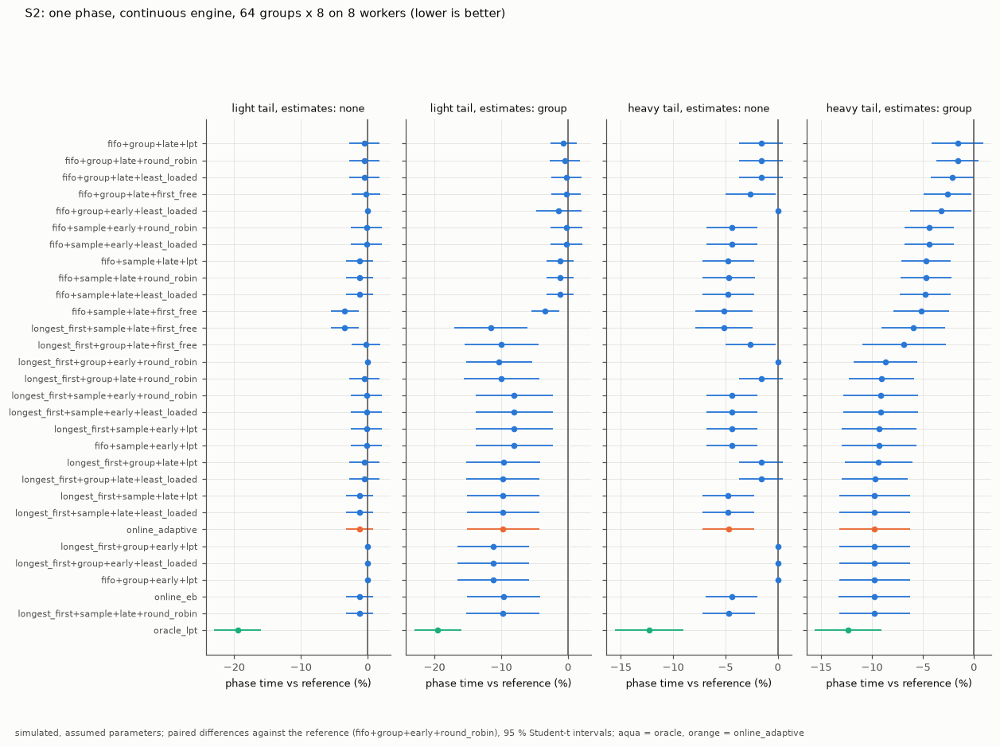
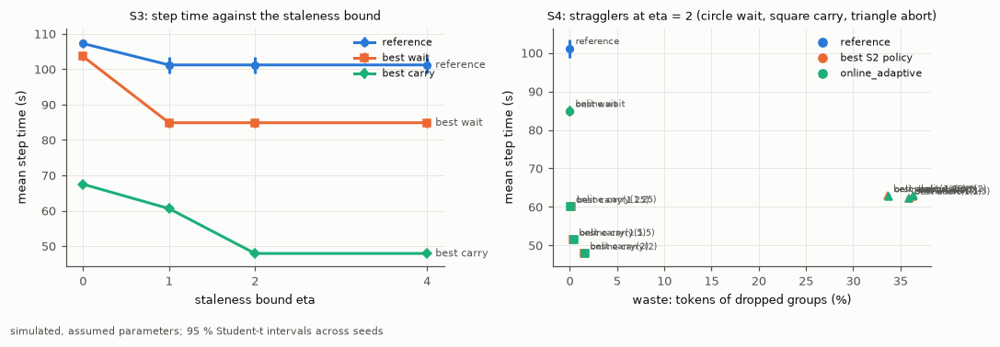
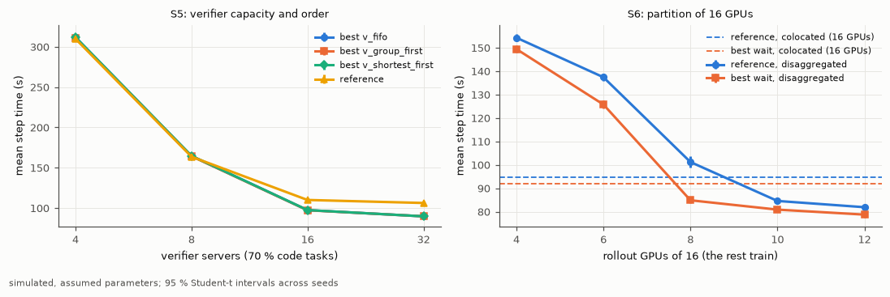
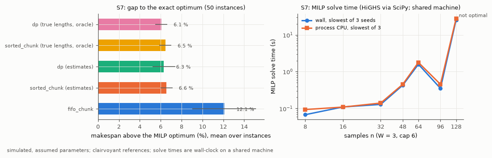
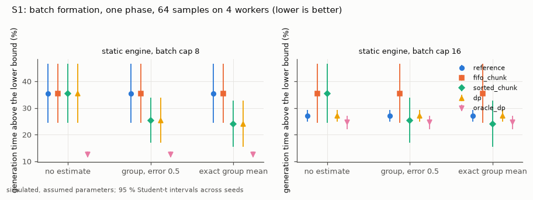
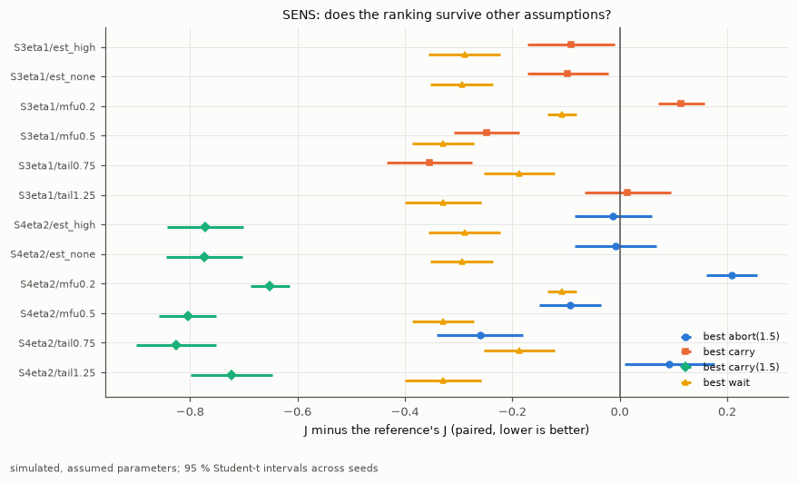
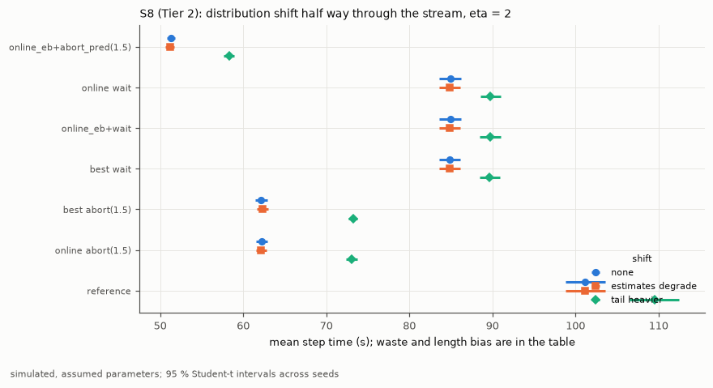
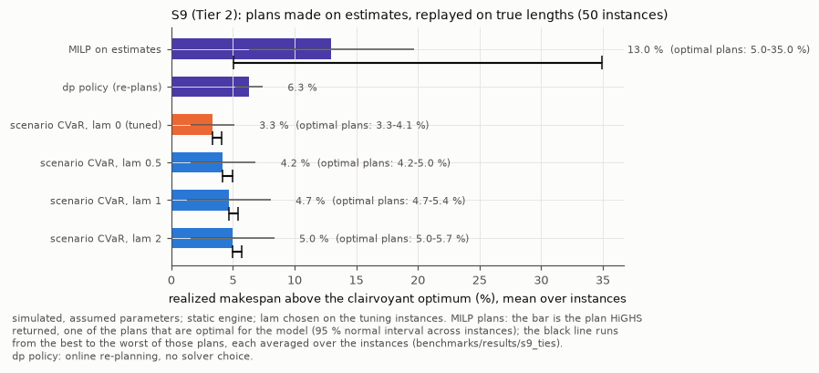
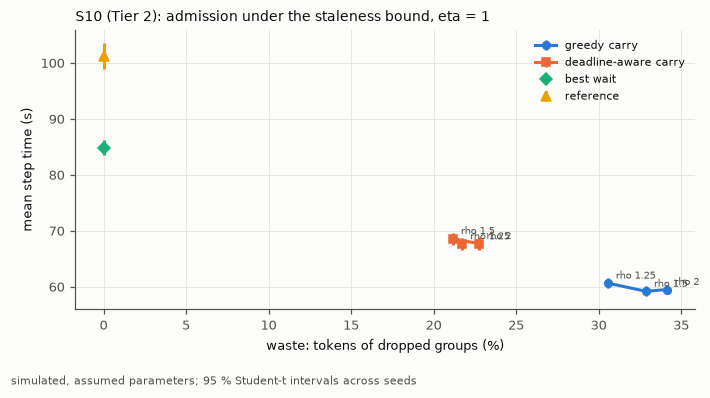
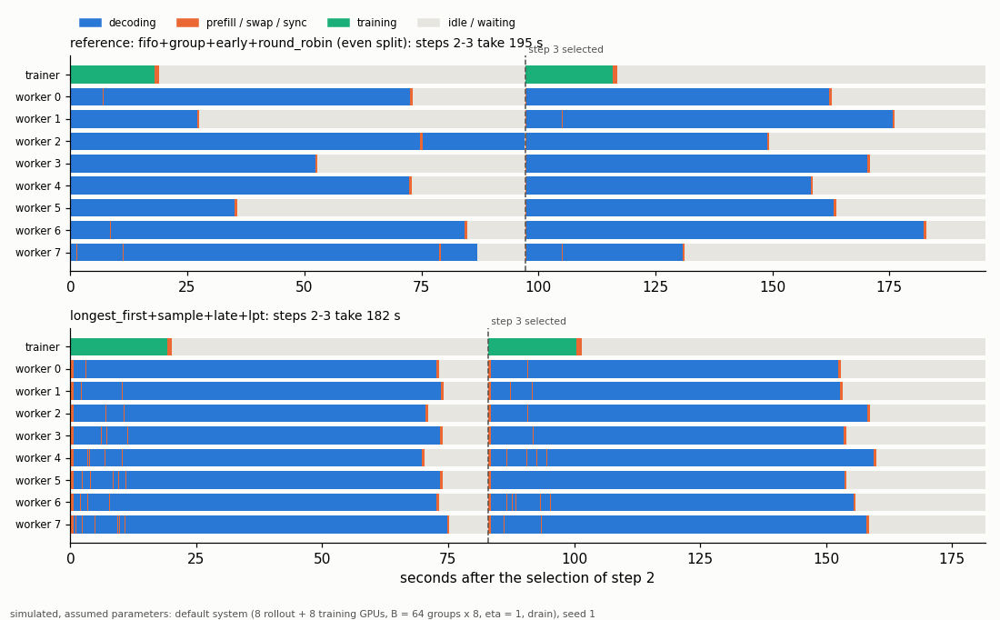

# Benchmarks

Every scheduling result here comes from the simulator, with assumed parameters (`docs/simulator.md`); the simulator has no model of learning, so staleness and length bias are measured quantities only.

## Reproduce

With the environment of the main README active, from the repository root:

```bash
python -m rollout_engine.bench tune --workers 4
python -m rollout_engine.bench --workers 4
python -m rollout_engine.bench microbench
python scripts/s9_tie_ranges.py --workers 4
python scripts/plot_results.py
python scripts/plot_timeline.py
```

The first command regenerates `configs/tuned/tuned.json` (and the S7/S9 tuning tables) from the tuning seeds only. The file records the hash of the experiment configuration it was tuned for; a full evaluation refuses a `tuned.json` made for another configuration (re-run the first command), and `--quick` continues with a warning and records `tuned_matches_config` in its manifest. The second runs the full evaluation into `benchmarks/results/full/` (`runs.csv`, `aggregate.csv`, `paired.csv`, `s7.csv`, `s9.csv`, `wall_*.csv`, `manifest.json`). `--quick` (3 seeds, 12 steps, fewer scenarios and policies) writes `benchmarks/results/quick/`. Workers default to half the logical processors (`--workers N` or `BENCH_WORKERS`); the committed tuning and evaluation used 8, the committed quick run 4. Traces are generated into `outputs/traces/` (git-ignored) and replayed from those files; `configs/traces/sample.csv` is the small committed sample used by the tests and the demo.

The optional solver cross-check runs outside the result environment: `python scripts/solver_crosscheck.py` in an environment that has `highspy` and, optionally, a licensed `gurobipy`.

## Protocol

**Revision.** The protocol below was revised after the results of the previous evaluation (commit `3310a8d`) had been seen: 10 tuning seeds instead of 5 (1000–1004), and single-phase weights 1, 0.5, 0.25 instead of 1, 0.5, 1 (the padding weight 1 had no recorded reason; the revised weights equal the closed-loop weights of the first three positions). Tuning and the whole evaluation were then re-run on a newer software stack (NumPy 2.5.4, SciPy 1.18.1 with HiGHS 1.12.0, previously NumPy 1.26.4, SciPy 1.13.1, whose vendored HiGHS reports 1.2.0). Every result below comes from the re-run, except the solver cross-check and the decision-cost microbenchmark (see their sections).

- **Seeds.** Tuning seeds 1000–1009; evaluation seeds 1–20 (10 for SENS); S7 and S9: 50 tuning instances (seeds 5000–5049) and 50 evaluation instances (6000–6049). A seed fixes the whole trace (prompts, lengths, estimates, verifier times), so every policy sees the same workload (common random numbers).
- **Objective.** `J` of `docs/contracts.md` section 4, normalized per cell by the reference policy's mean on the tuning seeds (`R_step`, `R_phase`). Weights 1, 0.5, 0.25, 1, 1 (closed loop) and 1, 0.5, 0.25 (single phase); in a cell where no configuration evaluated on the tuning seeds (every policy's defaults and every search candidate) differs from the reference by more than two standard errors of the paired difference on a term, that term's weight is 0 for every policy (`configs/tuned/tuned.json`, `term_check`). Every metric is reported, not only `J`.
- **Tuning.** Equal budget: every policy with tunable parameters gets 6 random configurations from its grid (the whole grid when smaller; search seed 2026), evaluated on the tuning seeds; the lowest mean `J` wins. Grids: `window_groups` {4, 8, 16, 32, 64}, `k0` {0.5, 1, 2, 4, 8}, `rho` {1.25, 1.5, 2} (where `rho` is not the varied dimension), `batch_size` {2, 4, 8, 16} (up to the batch cap), `kappa` {1.5, 2, 3, 4}, `deadline` {0.5, 1, 1.5, 2}. The **best S2 policy** (lowest tuned `J` in S2 heavy/group among deployable policies) fixes the other parts in S3–S6, S8, S10, and SENS ("vary one dimension at a time"). The tuned configuration (`tune` on `05f833f`) was committed before the reported evaluation of `0855d05`; an earlier evaluation (`777766d`) led to a fix of the tuning procedure and was superseded (see Results). Ties in tuning go to the first candidate by name (in S2 `least_loaded` and `lpt` tied exactly for the best policy) and, for S9's `lam`, to the first value in sorted order. The result manifests record the commit.
- **Statistics.** Mean and 95 % Student-t interval across seeds; paired differences against the reference policy on the common seeds with their intervals; win/tie/loss counts with a 1 % relative tie band.
- **Checks on every run.** The accounting identities (check 4) and the staleness invariants (check 5) run on every simulated run of the evaluation; the manifest lists violations (there must be none).

## Scenarios

| Id | What varies | Fixed parts |
|---|---|---|
| S1 | static engine, one phase: batch formation `fifo_chunk`, `sorted_chunk`, `dp`, `oracle_dp` under estimate models none / group (error 0.5) / group (exact), batch caps 8 and 16 | 64 samples (8 groups of 8), one prompt length (512), 4 workers, heavy tail, `math` only |
| S2 | continuous engine, one phase: order (`fifo`, `longest_first`) × dispatch (`group`, `sample`) × binding (`early`, `late`) × assignment (`round_robin`, `least_loaded`, `lpt`, and `first_free` under late), `online_adaptive`, `online_eb`, `oracle_lpt`; light (log-sd 0.4) and heavy (1.1) tails × estimates none / group (error 0.3) | 64 groups of 8 on 8 workers, `math` only |
| S3 | closed loop, `eta` in {0, 1, 2, 4}: reference, best S2 + `wait`, best S2 + `carry(rho)`; at `eta = 1` the `inflight` modes `swap` and `interrupt` (the base cells use `drain`) | default system |
| S4 | stragglers at `eta = 2`: `wait`, `carry(rho)`, `abort(rho)`, `rho` in {1.25, 1.5, 2}, for the best S2 policy and for `online_adaptive` | default system |
| S5 | verifier: 4, 8, 16, 32 servers × orders `fifo`, `group_first`, `shortest_first` (best S2 + `wait`) | 70 % `code` tasks |
| S6 | partition of 16 GPUs: rollout GPUs 4, 6, 8, 10, 12 (the rest train) and colocated (switch 3 s), reference and best S2 + `wait` | `eta = 1` |
| S7 | exact references on small static instances: MILP optimum, DP, lower bound, gaps of `fifo_chunk`, `sorted_chunk`, `dp` with estimated and true lengths; MILP solve time against `n` | 8–16 samples, 2–3 workers, caps 4–6 |
| S8 | distribution shift half way through the stream: none / tail heavier (log-sd × 1.3 after the shift, estimates keep the old calibration) / estimates degrade (error 0.3 → 1.2); reference, best S2, `online_adaptive`, `online_eb` with `wait` and with `abort(1.5)` / `abort_pred(1.5, kappa)` | `eta = 2` |
| S9 | static plans made on estimates, replayed on the true lengths: MILP on estimates, scenario MILP with CVaR (`lam` tuned), the re-planning `dp` policy, against the clairvoyant optimum | S7 instances |
| S10 | admission under the bound: greedy `carry(rho)` against deadline-aware `carry(rho)` for `rho` in {1.25, 1.5, 2}, plus `wait` and the reference | `eta = 1` |
| SENS | on S3 (`eta = 1`) and S4 (`rho = 1.5`): length tail × 0.75 and × 1.25, estimates none and error 1.0, training MFU 0.2 and 0.5 | 10 seeds |

Default system (`docs/simulator.md` section 9): 16 GPUs (8 rollout workers with `tp = 1`, 8 training), a 7.6 B-parameter model on 80 GB GPUs, `max_seqs` 32, `max_tokens` 8192, `B = 64` groups of 8 samples, `T = 24` steps (`warmup_steps = 2`), `eta = 1`, `drain`, 32 verifier servers, heavy tail with group estimates (error 0.3), 60 % `math` / 40 % `code`.

## Results

Evaluation of commit `0855d05` (manifest: `benchmarks/results/full/manifest.json`): 5300 simulated runs, 0 accounting or staleness violations, 420.5 s on 8 worker processes (an x86-64 desktop CPU with 32 logical CPUs, Windows 11, Python 3.12, NumPy 2.5.4, SciPy 1.18.1 with HiGHS 1.12.0). Tuning: 330 s on 8 worker processes (`wall_tuning_s` in `configs/tuned/tuned.json`). Compared with the previous evaluation (`3310a8d`), step and phase times are unchanged except where a tuned parameter changed: S1 `sorted_chunk` with group estimates (batch size 4 → 8), S3 `carry` at `eta = 1` (`rho` 1.5 → 1.25) and the six SENS cells built on it, and four S2 policies whose `window_groups` or `k0` changed (`online_adaptive` in heavy/none and three `longest_first` policies in light/group, by at most 0.06 s). J values change everywhere with the normalizers (the reference means, now on 10 tuning seeds) and with the weights in S1 (padding 0.25), in S5 with 4 servers (no step term), and in two S6 cells (no straggler term). S9's point-estimate plan changes with the solver version (see S9). The commit IDs cited here and recorded in the manifests belong to the development history, which is not published. **A first evaluation (commit `777766d`) was superseded**: it exposed a flaw in the tuning procedure (the per-cell term check ran on default parameters only, so in S1 with batch cap 16 the phase-time term was dropped and the search then picked two-sample batches with a 75 % longer phase; the superseded files are kept outside the repository); the check now covers every configuration evaluated on the tuning seeds, and tuning and the whole evaluation were re-run.



- **S1 (static batching, one phase).** With batch cap 8, `dp` on estimates shortens the phase from 60.0 s (reference: full FIFO batches) to 54.9–55.4 s when group estimates exist and does nothing without estimates (every sample then looks alike); `sorted_chunk`, now tuned to full 8-sample batches, gives the same times, and the oracle `dp` reaches 51.5 s. With cap 16 the full-batch policies run one round of four batches, so the batch holding the longest sample sets the phase (58.5 s for the reference, 58.4 s for `dp` with estimates, 57.0 s for the oracle), while with group estimates `sorted_chunk` with 8-sample batches runs two rounds and finishes in 54.9–55.4 s (60.0 s without estimates), with less padding than the reference and `dp` (53 % against 62–66 %; the oracle 42 %). The tuned batch size of `sorted_chunk` changed from 4 to 8 with the revised protocol; 8 and 4 are within noise on the tuning seeds, so the change is no finding about batch sizes. J weighs idle time and padding next to the phase: at cap 16 it prefers `fifo_chunk` with 8-sample batches (60.0 s, 29 % idle, 53 % padding; 13 wins of 20) to the reference (58.5 s, 40 % idle, 66 % padding), and each of the two terms alone outweighs the 2.5 % longer phase; it ranks the oracle `dp` last (57.0 s, 63 % idle). The phase-time column is the one to read for speed.
- **S2 (continuous engine, one phase).** The detailed findings follow below the list; the table below lists all 31 policies of the heavy-tail, group-estimate cell. Light tail: the tuned best S2 policy is 9.7 % ± 5.4 % faster than the reference with estimates and 1.2 % ± 2.0 % without (10/6/4, the interval includes 0); the fastest policies in those cells, picked here after the fact (`longest_first+sample+late+first_free` and `fifo+sample+late+first_free`), reach 11.6 % and 3.4 %. The reference sits 58 % above the lower bound against 27 % for the oracle.
- **S3, S4, S10 (staleness, stragglers, admission).** `carry` is cheap from `eta = 2` on and wasteful at `eta <= 1` (dead groups); `abort` always throws away about a third of the generated tokens and biases the consumed lengths toward short responses by about −25 %; deadline-aware admission trades step time for less waste.
- **S5 (verifier).** (In the 4- and 8-server cells the step-time term of J has weight 0 because no policy moved it on the tuning seeds, so J ranks policies there by idle time and straggler delay; in four of the six S6 cells the straggler term has weight 0.) At 4 and 8 servers verification is the bottleneck (trainer waiting 88–94 % of the time; step times 164–312 s for every policy); at 16 and 32 servers the best S2 policy is 11–16 % faster than the reference again (97.4 vs 110.0 s and 89.7 vs 106.3 s). `shortest_first` lowers the mean verifier delay by 12–25 % (most with few servers) without changing step times; `group_first` does not help.
- **S6 (partition).** Step time falls as rollout GPUs grow from 4 to 12 (reference 154.3 → 81.9 s); colocating all 16 GPUs costs 92–95 s per step with the assumed 3 s switches.
- **S7, S9 (exact references, risk).** The DP and the MILP agree with brute force in the tests; on the 50 evaluation instances the MILP was solved to optimality every time; see the tables. S9's planning MILPs can have several optimal plans with different realized makespans, and the solver returns one of them: the S9 table gives each model's range over its optimal plans (`results/s9_ties/`, written by `python scripts/s9_tie_ranges.py --workers 8` on `0855d05`, 100 instances, 0 problems; both extreme plans of every range are checked for coverage, model optimality, and replay). Of the 50 evaluation instances, the tuned scenario model (`lam = 0`, range 1.033–1.041) has a range on 1 and the point-estimate model (range 1.050–1.350) on 33. Compared with the most favorable point-estimate plan, which can only be identified with the true lengths, the worst optimal `lam = 0` plan is better on 9 instances, equal on 20, and worse on 21 (paired difference 0.9 ± 3.1 percentage points, within noise). Between the previous and the current solver version (HiGHS 1.2.0 and 1.12.0) the realized makespan of the returned plan changed on 29 of the 50 tuning instances for the point-estimate model and on 2 to 4 for the scenario models (`configs/tuned/s9_tuning.csv` before and after the re-tuning), while every optimum stayed the same.
- **SENS.** Every paired comparison is in `paired.csv` (`scenario = SENS`); the figure shows J differences against the reference per variation.










### Findings in detail

- **One phase, continuous engine (S2).** With group-level length estimates and a heavy tail, ordering work by estimated length (launching the longest groups first, or assigning by LPT) shortens the phase by 9.7 % ± 3.5 % against the reference (19 wins, 1 loss over 20 seeds) and brings it from 26 % to 14 % above the lower bound; dispatching single samples with late binding gives the same phase time and lowers GPU idle time further (14 % against 20 % for the same ordering with group dispatch). The oracle that knows every length reaches 11 % above the bound. Without estimates the gain shrinks to 4–5 % (3.4–4.1 s) and comes from dispatching single samples. Under late binding the `least_loaded` and `lpt` assignments tie exactly and `round_robin` differs on 7 of 20 seeds by at most 0.21 s (at most decision instants a single worker can admit; all three average 70.9 s), while `first_free` is slower (73.9 s against 70.9 s); `online_adaptive` and `online_eb`, the same parts with other estimators, give the same phase times.
- **Closed loop (S3).** At `eta = 1` the best S2 policy with `wait` cuts the mean step time from 101.2 s to 84.9 s. Letting groups run on across steps (`carry(rho)`, `rho` tuned per cell between 1.25 and 2) brings it to 60.6 s at `eta = 1` (`rho = 1.25`), but almost a third of the generated tokens then belong to groups that go stale and are dropped (waste 31 %, length bias −23 %: the dropped groups are the long ones); at `eta = 0` carrying has 37 % shorter steps but wastes 43 % of the tokens and loses on J (1.67 against 1.40, 20 of 20 seeds); from `eta = 2` on it costs almost nothing (`carry(2)`: waste 1.5 % at `eta = 2`, none at `eta = 4`; step time 47.9 s). With `swap` or `interrupt` instead of `drain` at `eta = 1`, the reference's step time falls from 101.2 s to 88.9 s / 90.5 s and the share of consumed tokens generated under older weights from 99 % to 61 %.
- **Stragglers (S4, `eta = 2`).** `carry(rho)` beats `abort(rho)` at every `rho`: `carry(2)` reaches 47.9 s with 2 % waste and a mean staleness of 1.19; `abort(1.5)` gets 62.2 s while throwing away 36 % of the generated tokens and biasing the consumed lengths by −25 %. Learning lengths online (`online_adaptive`) changes nothing measurable here.
- **Verifier (S5, 70 % code tasks).** With 4 or 8 verifier servers the trainer waits 88–94 % of the time and the rollout policy no longer matters (step times 164–312 s for every policy); `shortest_first` lowers the mean verifier delay (55.7 s → 42.1 s at 8 servers) without changing the step time.
- **Partition (S6, 16 GPUs).** 12 rollout + 4 training GPUs gives the lowest step time for both policies (78.7 s and 81.9 s); colocated 92.1 s and 94.8 s.
- **Exact references (S7, 50 instances).** `dp` and `sorted_chunk` end 6.3 % and 6.6 % above the MILP optimum, `fifo_chunk` 12.1 %; the lower bound `max(DP / W, cost(1, Lmax))` equals the optimum on 40 of 50 heavy-tailed instances. In the solve-time sweep (wall clock, one solve at a time in the main process of the evaluation, after its 8-worker simulation pool had finished) HiGHS 1.12 (SciPy 1.18) proves optimality in at most 1.6 s up to 96 samples; at 128 samples it proves two of three seeds (4.5 s and 4.6 s) and stops at the node limit (200 000 nodes, 25.6 s) on the third.
- **Sensitivity (SENS).** The best S2 policy with `wait` beats the reference under every varied assumption (10 of 10 seeds each: tail × 0.75 / × 1.25, no estimates, estimate error 1.0, training MFU 0.2 / 0.5), and `carry(1.5)` at `eta = 2` wins everywhere. `carry` at `eta = 1` loses at MFU 0.2 (0 of 10) and is inconclusive with the heavier tail; `abort(1.5)` wins only with the lighter tail and at MFU 0.5, ties without estimates or with error 1.0, and loses at MFU 0.2 and with the heavier tail.
- **Shift, scenario planning, admission (S8–S10).** *Shift (S8):* degrading the estimates half way changes step times by less than 0.3 % (closed-loop step times are insensitive to the estimates, unlike the one-phase S2); a heavier tail lengthens the steps of the `wait` policies by 5.6–5.7 %, of the reference by 8.2 %, and of the `abort` policies by 17.5–17.7 %; `online_eb` with prediction-based dropping was tuned to `kappa = 4`, which drops almost nothing (it then behaves like `carry(1.5)`: 51.3 s, 0.5 % waste). *Scenario planning for static batches (S9):* the planning MILPs can have several optimal plans whose realized makespans differ, and the solver returns one of them, so each model's result is a range over its optimal plans (`benchmarks/results/s9_ties/`, `scripts/s9_tie_ranges.py`). On the 50 evaluation instances a plan made on point estimates ends 5.0–35.0 % above the clairvoyant optimum on average, depending on which optimal plan is taken (33 instances have more than one realized makespan; the plan HiGHS 1.12 returned ends 13.0 % above, one choice of the solver). The plan that minimizes the expected makespan over sampled length scenarios (`lam = 0`) ends 3.3–4.1 % above (one instance with a range), the re-planning `dp` policy 6.3 %. With a range on one instance against 33, the `lam = 0` result depends far less on which optimal plan the solver returns. Compared with the most favorable point-estimate plan, which can only be identified with the true lengths, the worst optimal `lam = 0` plan is better on 9 instances, equal on 20, and worse on 21 (paired difference 0.9 ± 3.1 percentage points, within noise). `lam = 0` was chosen on the tuning instances by the returned plans (mean ratio 1.0739 against 1.0741 for `lam = 1` and 1.084 and 1.094 for `lam = 0.5` and 2); the ranges of the four `lam` values overlap there, so the tuning instances do not identify `lam` (the choice follows which optimal plans the solver returns). *Admission (S10):* deadline-aware `carry` lowers waste from 31–34 % to 21–23 % at 12–16 % longer steps; both remain behind `wait` on J at `eta = 1`.

| Policy (S3/S4 cells) | J | step time (s) | GPU idle | P95 straggler (s) | waste | length bias | W/T/L |
|---|---|---|---|---|---|---|---|
| reference, `eta = 1` | 1.461 ± 0.039 | 101.2 ± 2.4 | 58 % | 65.6 ± 5.9 | 0 % | 0 % | – |
| best S2 + `wait`, `eta = 1` | 1.169 ± 0.025 | 84.9 ± 1.3 | 48 % | 34.5 ± 4.2 | 0 % | 0 % | 20/0/0 |
| best S2 + `carry(1.25)`, `eta = 1` | 1.364 ± 0.014 | 60.6 ± 0.9 | 37 % | 16.3 ± 1.1 | 31 % | −23 % | 17/2/1 |
| best S2 + `carry(2)`, `eta = 2` | 0.673 ± 0.007 | 47.9 ± 0.5 | 31 % | 6.9 ± 0.7 | 2 % | −1 % | 20/0/0 |
| best S2 + `abort(1.5)`, `eta = 2` | 1.458 ± 0.010 | 62.2 ± 0.7 | 38 % | 17.1 ± 0.9 | 36 % | −25 % | 8/3/9 |

J weighs step time, GPU idle time, the P95 straggler delay, waste, and |length bias| (`docs/contracts.md` section 4; the reference's J is about 1.46 in these cells), with weights fixed before the evaluation; the table above shows every term. "Best S2" is `longest_first+sample+late+least_loaded` (window 32), chosen on the tuning seeds, where it tied exactly with the `lpt` assignment (the tie was broken by name). In S5 with 4 and with 8 servers the step-time term of J got weight 0 (no policy moved it on the tuning seeds), so J differences there are idle and straggler differences, and in four of the six S6 cells the straggler term got weight 0; read the step-time column next to J. Per-cell weights are in `configs/tuned/tuned.json`.



*Illustration, not part of the evaluation: one separate 6-step run (seed 1, default system) of the reference and of `longest_first+sample+late+lpt`, GPU states between the selections of steps 2 and 4 (`scripts/plot_timeline.py`).*

### Tables (generated by `scripts/plot_results.py`)

<!-- generated by scripts/plot_results.py from benchmarks/results; simulated, assumed parameters -->

**Closed loop** (mean ± 95 % CI across seeds; W/T/L = paired wins/ties/losses on J against the reference, tie band 1 %)

| Scenario | Policy | J | step time (s) | GPU idle | P95 straggler (s) | waste | length bias | staleness | W/T/L |
|---|---|---|---|---|---|---|---|---|---|
| S3 eta1 | best_s2+carry | 1.364 ± 0.014 | 60.6 ± 0.9 | 37 % ± 0 | 16.3 ± 1.1 | 31 % ± 0 | -23 % ± 0 | 0.98 ± 0.00 | 17/2/1 |
| S3 eta1 | best_s2+wait | 1.169 ± 0.025 | 84.9 ± 1.3 | 48 % ± 1 | 34.5 ± 4.2 | 0 % ± 0 | 0 % ± 0 | 1.00 ± 0.00 | 20/0/0 |
| S3 eta1 | reference | 1.461 ± 0.039 | 101.2 ± 2.4 | 58 % ± 1 | 65.6 ± 5.9 | 0 % ± 0 | 0 % ± 0 | 0.99 ± 0.00 | – |
| S3 eta0 | best_s2+carry | 1.671 ± 0.015 | 67.5 ± 0.8 | 50 % ± 0 | 13.6 ± 1.1 | 43 % ± 0 | -33 % ± 0 | 0.00 ± 0.00 | 0/0/20 |
| S3 eta0 | best_s2+wait | 1.333 ± 0.021 | 103.6 ± 1.2 | 57 % ± 0 | 33.6 ± 3.7 | 0 % ± 0 | 0 % ± 0 | 0.00 ± 0.00 | 18/2/0 |
| S3 eta0 | reference | 1.403 ± 0.019 | 107.3 ± 1.2 | 62 % ± 0 | 39.1 ± 3.7 | 0 % ± 0 | 0 % ± 0 | 0.00 ± 0.00 | – |
| S4 eta2 | best_s2+abort(1.25) | 1.432 ± 0.012 | 62.8 ± 0.8 | 38 % ± 0 | 16.6 ± 0.8 | 34 % ± 0 | -24 % ± 1 | 0.97 ± 0.00 | 11/2/7 |
| S4 eta2 | best_s2+abort(1.5) | 1.458 ± 0.010 | 62.2 ± 0.7 | 38 % ± 0 | 17.1 ± 0.9 | 36 % ± 0 | -25 % ± 1 | 0.97 ± 0.00 | 8/3/9 |
| S4 eta2 | best_s2+abort(2) | 1.466 ± 0.011 | 62.6 ± 0.9 | 38 % ± 0 | 17.0 ± 1.0 | 36 % ± 0 | -25 % ± 0 | 0.97 ± 0.00 | 7/3/10 |
| S4 eta2 | best_s2+carry(1.25) | 0.808 ± 0.010 | 60.0 ± 0.8 | 35 % ± 0 | 13.4 ± 1.0 | 0 % ± 0 | -0 % ± 0 | 0.89 ± 0.01 | 20/0/0 |
| S4 eta2 | best_s2+carry(1.5) | 0.697 ± 0.008 | 51.4 ± 0.7 | 32 % ± 0 | 7.2 ± 0.5 | 0 % ± 0 | -0 % ± 0 | 0.99 ± 0.01 | 20/0/0 |
| S4 eta2 | best_s2+carry(2) | 0.673 ± 0.007 | 47.9 ± 0.5 | 31 % ± 0 | 6.9 ± 0.7 | 2 % ± 0 | -1 % ± 0 | 1.19 ± 0.01 | 20/0/0 |
| S4 eta2 | best_s2+wait | 1.169 ± 0.025 | 84.9 ± 1.3 | 48 % ± 1 | 34.5 ± 4.2 | 0 % ± 0 | 0 % ± 0 | 1.00 ± 0.00 | 20/0/0 |
| S4 eta2 | online_adaptive+abort(1.25) | 1.436 ± 0.014 | 62.7 ± 0.7 | 38 % ± 0 | 17.2 ± 1.3 | 34 % ± 1 | -24 % ± 1 | 0.97 ± 0.00 | 10/3/7 |
| S4 eta2 | online_adaptive+abort(1.5) | 1.459 ± 0.011 | 62.2 ± 0.7 | 38 % ± 0 | 17.0 ± 0.9 | 36 % ± 0 | -25 % ± 0 | 0.97 ± 0.00 | 8/2/10 |
| S4 eta2 | online_adaptive+abort(2) | 1.474 ± 0.016 | 62.9 ± 0.8 | 38 % ± 0 | 18.1 ± 1.6 | 36 % ± 1 | -25 % ± 1 | 0.97 ± 0.00 | 8/1/11 |
| S4 eta2 | online_adaptive+carry(1.25) | 0.805 ± 0.010 | 60.1 ± 0.9 | 35 % ± 0 | 12.6 ± 0.9 | 0 % ± 0 | -0 % ± 0 | 0.89 ± 0.02 | 20/0/0 |
| S4 eta2 | online_adaptive+carry(1.5) | 0.698 ± 0.007 | 51.4 ± 0.6 | 32 % ± 0 | 7.4 ± 0.7 | 0 % ± 0 | -0 % ± 0 | 0.99 ± 0.01 | 20/0/0 |
| S4 eta2 | online_adaptive+carry(2) | 0.672 ± 0.007 | 47.8 ± 0.5 | 31 % ± 0 | 7.1 ± 0.7 | 2 % ± 0 | -1 % ± 0 | 1.19 ± 0.01 | 20/0/0 |
| S4 eta2 | online_adaptive+wait | 1.168 ± 0.025 | 84.9 ± 1.3 | 48 % ± 1 | 33.9 ± 4.2 | 0 % ± 0 | 0 % ± 0 | 1.00 ± 0.00 | 20/0/0 |
| S4 eta2 | reference | 1.461 ± 0.039 | 101.2 ± 2.4 | 58 % ± 1 | 65.6 ± 5.9 | 0 % ± 0 | 0 % ± 0 | 0.99 ± 0.00 | – |
| S5 servers8 | best_s2+v_fifo | 0.413 ± 0.008 | 164.6 ± 2.1 | 72 % ± 0 | 35.1 ± 4.4 | 0 % ± 0 | 0 % ± 0 | 1.00 ± 0.00 | 13/4/3 |
| S5 servers8 | best_s2+v_group_first | 0.427 ± 0.007 | 164.3 ± 1.9 | 72 % ± 0 | 44.0 ± 4.1 | 0 % ± 0 | 0 % ± 0 | 1.00 ± 0.00 | 6/5/9 |
| S5 servers8 | best_s2+v_shortest_first | 0.415 ± 0.008 | 164.7 ± 2.1 | 72 % ± 0 | 35.8 ± 4.3 | 0 % ± 0 | 0 % ± 0 | 1.00 ± 0.00 | 11/6/3 |
| S5 servers8 | reference | 0.422 ± 0.007 | 163.7 ± 1.9 | 73 % ± 0 | 37.1 ± 3.9 | 0 % ± 0 | 0 % ± 0 | 0.99 ± 0.00 | – |
| S6 colocated | best_s2+wait | 1.091 ± 0.016 | 92.1 ± 1.2 | 23 % ± 1 | 33.3 ± 3.3 | 0 % ± 0 | 0 % ± 0 | 0.00 ± 0.00 | 20/0/0 |
| S6 colocated | reference | 1.180 ± 0.013 | 94.8 ± 0.9 | 35 % ± 1 | 36.0 ± 3.7 | 0 % ± 0 | 0 % ± 0 | 0.00 ± 0.00 | – |

**One phase, S2 heavy tail with group estimates** (every policy)

| Policy | J | phase time (s) | gap to lower bound | GPU idle | W/T/L |
|---|---|---|---|---|---|
| oracle_lpt | 0.899 ± 0.009 | 68.9 ± 1.2 | 11 % ± 1 | 7 % ± 4 | 20/0/0 |
| longest_first+sample+late+round_robin | 0.961 ± 0.021 | 70.9 ± 1.8 | 14 % ± 2 | 14 % ± 4 | 19/0/1 |
| online_eb | 0.961 ± 0.020 | 70.9 ± 1.8 | 14 % ± 2 | 14 % ± 4 | 19/0/1 |
| online_adaptive | 0.961 ± 0.021 | 70.9 ± 1.8 | 14 % ± 2 | 14 % ± 4 | 19/0/1 |
| longest_first+sample+late+least_loaded | 0.962 ± 0.021 | 70.9 ± 1.8 | 14 % ± 2 | 14 % ± 4 | 19/0/1 |
| longest_first+sample+late+lpt | 0.962 ± 0.021 | 70.9 ± 1.8 | 14 % ± 2 | 14 % ± 4 | 19/0/1 |
| fifo+sample+early+lpt | 0.967 ± 0.026 | 71.3 ± 1.9 | 14 % ± 2 | 15 % ± 4 | 18/1/1 |
| longest_first+sample+early+lpt | 0.967 ± 0.026 | 71.3 ± 1.9 | 14 % ± 2 | 15 % ± 4 | 18/1/1 |
| longest_first+sample+early+least_loaded | 0.969 ± 0.026 | 71.4 ± 2.0 | 14 % ± 2 | 15 % ± 4 | 18/1/1 |
| longest_first+sample+early+round_robin | 0.969 ± 0.026 | 71.4 ± 2.0 | 14 % ± 2 | 15 % ± 4 | 18/1/1 |
| longest_first+group+late+least_loaded | 0.989 ± 0.019 | 70.9 ± 1.8 | 14 % ± 2 | 20 % ± 4 | 18/1/1 |
| fifo+group+early+lpt | 0.990 ± 0.023 | 70.9 ± 1.9 | 14 % ± 2 | 20 % ± 4 | 18/0/2 |
| longest_first+group+early+least_loaded | 0.990 ± 0.023 | 70.9 ± 1.9 | 14 % ± 2 | 20 % ± 4 | 18/0/2 |
| longest_first+group+early+lpt | 0.990 ± 0.023 | 70.9 ± 1.9 | 14 % ± 2 | 20 % ± 4 | 18/0/2 |
| longest_first+group+late+lpt | 0.995 ± 0.019 | 71.2 ± 1.9 | 14 % ± 2 | 20 % ± 3 | 19/0/1 |
| longest_first+group+late+round_robin | 1.005 ± 0.024 | 71.4 ± 2.0 | 15 % ± 2 | 22 % ± 4 | 18/1/1 |
| longest_first+group+early+round_robin | 1.012 ± 0.023 | 71.8 ± 1.9 | 15 % ± 2 | 22 % ± 4 | 18/1/1 |
| fifo+sample+early+least_loaded | 1.021 ± 0.019 | 75.1 ± 2.1 | 21 % ± 3 | 16 % ± 3 | 18/0/2 |
| fifo+sample+early+round_robin | 1.021 ± 0.019 | 75.1 ± 2.1 | 21 % ± 3 | 16 % ± 3 | 18/0/2 |
| fifo+sample+late+first_free | 1.024 ± 0.018 | 74.5 ± 2.1 | 20 % ± 3 | 18 % ± 3 | 16/1/3 |
| fifo+sample+late+least_loaded | 1.027 ± 0.021 | 74.8 ± 2.1 | 20 % ± 3 | 18 % ± 3 | 18/2/0 |
| fifo+sample+late+round_robin | 1.028 ± 0.022 | 74.9 ± 2.1 | 20 % ± 3 | 18 % ± 3 | 18/0/2 |
| fifo+sample+late+lpt | 1.028 ± 0.020 | 74.9 ± 2.1 | 20 % ± 2 | 18 % ± 3 | 18/2/0 |
| longest_first+sample+late+first_free | 1.037 ± 0.021 | 73.9 ± 2.2 | 19 % ± 3 | 22 % ± 3 | 13/4/3 |
| longest_first+group+late+first_free | 1.054 ± 0.035 | 73.2 ± 2.4 | 17 % ± 3 | 27 % ± 5 | 13/2/5 |
| fifo+group+early+least_loaded | 1.070 ± 0.035 | 76.0 ± 2.8 | 22 % ± 4 | 23 % ± 3 | 14/2/4 |
| fifo+group+late+first_free | 1.082 ± 0.038 | 76.5 ± 2.7 | 23 % ± 4 | 25 % ± 4 | 14/2/4 |
| fifo+group+late+least_loaded | 1.087 ± 0.034 | 76.9 ± 2.8 | 23 % ± 4 | 25 % ± 3 | 14/1/5 |
| fifo+group+late+lpt | 1.096 ± 0.038 | 77.3 ± 2.9 | 24 % ± 4 | 25 % ± 3 | 12/3/5 |
| fifo+group+late+round_robin | 1.099 ± 0.031 | 77.3 ± 2.6 | 24 % ± 3 | 26 % ± 3 | 13/1/6 |
| reference | 1.132 ± 0.050 | 78.6 ± 3.3 | 26 % ± 5 | 29 % ± 4 | – |

**S8: distribution shift half way through the stream** (eta = 2; J is normalized within each shift cell, so compare J within a cell; step-time change = relative to the same policy without shift)

| Shift | Policy | J | step-time change | step time (s) | waste | length bias |
|---|---|---|---|---|---|---|
| none | online_eb+abort_pred(1.5) | 0.699 ± 0.006 | – | 51.3 ± 0.5 | 0 % ± 0 | -1 % ± 0 |
| none | online_adaptive+wait | 1.168 ± 0.025 | – | 84.9 ± 1.3 | 0 % ± 0 | 0 % ± 0 |
| none | online_eb+wait | 1.169 ± 0.025 | – | 84.9 ± 1.3 | 0 % ± 0 | 0 % ± 0 |
| none | best_s2+wait | 1.169 ± 0.025 | – | 84.9 ± 1.3 | 0 % ± 0 | 0 % ± 0 |
| none | best_s2+abort(1.5) | 1.458 ± 0.010 | – | 62.2 ± 0.7 | 36 % ± 0 | -25 % ± 1 |
| none | online_adaptive+abort(1.5) | 1.459 ± 0.011 | – | 62.2 ± 0.7 | 36 % ± 0 | -25 % ± 0 |
| none | reference | 1.461 ± 0.039 | – | 101.2 ± 2.4 | 0 % ± 0 | 0 % ± 0 |
| estimates_degrade | online_eb+abort_pred(1.5) | 0.701 ± 0.007 | -0.3 % | 51.2 ± 0.5 | 1 % ± 0 | -1 % ± 0 |
| estimates_degrade | online_adaptive+wait | 1.168 ± 0.025 | -0.1 % | 84.9 ± 1.3 | 0 % ± 0 | 0 % ± 0 |
| estimates_degrade | online_eb+wait | 1.169 ± 0.025 | -0.1 % | 84.9 ± 1.2 | 0 % ± 0 | 0 % ± 0 |
| estimates_degrade | best_s2+wait | 1.170 ± 0.025 | -0.0 % | 84.8 ± 1.3 | 0 % ± 0 | 0 % ± 0 |
| estimates_degrade | best_s2+abort(1.5) | 1.459 ± 0.011 | +0.2 % | 62.3 ± 0.7 | 36 % ± 0 | -25 % ± 1 |
| estimates_degrade | reference | 1.461 ± 0.039 | +0.0 % | 101.2 ± 2.4 | 0 % ± 0 | 0 % ± 0 |
| estimates_degrade | online_adaptive+abort(1.5) | 1.467 ± 0.009 | -0.0 % | 62.2 ± 0.7 | 36 % ± 0 | -26 % ± 0 |
| tail_heavier | online_eb+abort_pred(1.5) | 0.729 ± 0.008 | +13.6 % | 58.3 ± 0.6 | 0 % ± 0 | -0 % ± 0 |
| tail_heavier | best_s2+wait | 1.135 ± 0.023 | +5.6 % | 89.7 ± 1.2 | 0 % ± 0 | 0 % ± 0 |
| tail_heavier | online_eb+wait | 1.135 ± 0.023 | +5.7 % | 89.7 ± 1.2 | 0 % ± 0 | 0 % ± 0 |
| tail_heavier | online_adaptive+wait | 1.136 ± 0.023 | +5.7 % | 89.8 ± 1.2 | 0 % ± 0 | 0 % ± 0 |
| tail_heavier | reference | 1.455 ± 0.039 | +8.2 % | 109.5 ± 3.0 | 0 % ± 0 | 0 % ± 0 |
| tail_heavier | online_adaptive+abort(1.5) | 1.539 ± 0.009 | +17.5 % | 73.1 ± 0.7 | 37 % ± 0 | -26 % ± 0 |
| tail_heavier | best_s2+abort(1.5) | 1.541 ± 0.011 | +17.7 % | 73.2 ± 0.5 | 38 % ± 1 | -26 % ± 1 |

**S6 partition planning**: the GPU split with the lowest mean step time, per policy (16 GPUs)

| Policy | best split | its step time (s) | colocated step time (s) |
|---|---|---|---|
| best_s2+wait | 12 rollout + 4 training GPUs | 78.7 ± 1.2 | 92.1 ± 1.2 |
| reference | 12 rollout + 4 training GPUs | 81.9 ± 0.9 | 94.8 ± 0.9 |

**S9: static plans made on estimates, replayed on the true lengths** (50 evaluation instances)

Realized makespan / clairvoyant optimum. A planning MILP can have several optimal plans with different realized makespans, and the solver (HiGHS) returns one of them: for the MILP plans, the first and the last column are the plan HiGHS returned, one choice among the optimal plans. The range is the mean over the instances of the best and of the worst plan that is optimal for the model (`benchmarks/results/s9_ties/`); the `dp` policy re-plans online and involves no solver choice.

| Plan | mean, plan returned by the solver | range over the model's optimal plans | instances with a range | worst instance, returned plan |
|---|---|---|---|---|
| MILP on estimates | 1.130 | 1.050–1.350 | 33 of 50 | 2.359 |
| dp policy (re-plans) | 1.063 | – (re-plans online) | – | 1.294 |
| scenario CVaR, lam 0 (tuned) | 1.033 | 1.033–1.041 | 1 of 50 | 1.409 |
| scenario CVaR, lam 0.5 | 1.042 | 1.042–1.050 | 1 of 50 | 1.532 |
| scenario CVaR, lam 1 | 1.047 | 1.047–1.054 | 1 of 50 | 1.686 |
| scenario CVaR, lam 2 | 1.050 | 1.050–1.057 | 1 of 50 | 1.686 |

**S7 exact references** (50 evaluation instances; statuses: ['optimal'])

| Plan | mean gap to the MILP optimum | worst gap |
|---|---|---|
| fifo_chunk | 12.1 % | 52.1 % |
| sorted_chunk | 6.6 % | 10.7 % |
| dp | 6.3 % | 29.4 % |
| sorted_chunk_oracle | 6.5 % | 10.7 % |
| oracle_dp | 6.1 % | 10.7 % |

### Solver cross-check (optional)

`benchmarks/results/solver_crosscheck.md` (run before this re-evaluation, on SciPy 1.13.1): SciPy's HiGHS 1.2.0, `highspy` 1.15.1, and Gurobi 12.0.2 (one thread) agree on all 50 S7 optima; on the sweep instance (seed 8000) all three prove n = 128, 192, 256 (Gurobi fastest); nothing in the results above depends on the other two solvers.

### Decision cost

`benchmarks/results/wall_decision_cost.csv` (wall clock, minimum of 5 repetitions, measured before this re-evaluation on NumPy 1.26.4 and SciPy 1.13.1 with HiGHS 1.2.0 and not repeated; process CPU time on Windows has a 15.6 ms resolution, so small values read 0): one policy invocation of the reference takes 0.04 / 0.53 / 22.5 ms with 64 / 512 / 4096 pending samples; `longest_first+sample+late+lpt` 0.55 / 2.6 / 7.6 ms (late binding places only what fits now); `online_adaptive` 0.56 / 2.7 / 7.0 ms; the static `dp` policy 0.9 / 8.8 / 91 ms; the DP alone 0.5 / 4.9 / 43 ms; the S7 MILP with 3 workers 35 ms (16 samples) and about 0.7 s (32 and 64 samples). A 24-step closed-loop run of the reference policy took a median 0.80 s wall time (about 32 000 instants per second) inside the 8-worker evaluation, on the same machine.

## Limitations

- Every engine parameter is derived from datasheet numbers with assumed efficiencies (`docs/simulator.md` section 9); nothing is fitted to a measurement. `scripts/calibrate_gpu.py` fits the iteration and prefill coefficients to a random-weight decoder in PyTorch on a local GPU, but it has not been run on a committed state.
- All response lengths are synthetic (log-normal with a group latent); no public dataset of reasoning-model responses is resampled.
- Staleness and length bias are measured quantities only; their effect on learning is not modeled.
- The engine has no KV preemption or swapping, chunked prefill, speculative decoding, or agentic rollouts that pause for tool calls: reservations are worst-case `max_tokens`, a prefill pauses the worker, and samples never pause.
- The live service is checked against the simulator on a virtual-time loop (check 9). `python -m rollout_engine.service.loadbench` measures its throughput and per-endpoint latency on the wall clock with mock workers, but it has not been run on a committed state. The service has no authentication, TLS, connection reuse, or second controller.
- There is no Redis queue adapter, Ray worker pool, vLLM or SGLang adapter tested against a real server, or gRPC transport.
- The S9 plans are not identified: the returned plan is the solver's choice among the plans that are optimal for a planning model, so the point-estimate plan's mean lies anywhere in 5.0–35.0 % above the optimum on the evaluation instances, and the `lam` ranges overlap on the tuning instances (`results/s9_ties/`).
- `configs/tuned/tuned.json` records the configuration hash but not the software stack, while S9's tuning depends on the solver version; the committed tuning ran on the stack of the evaluation, which the evaluation manifest records.
- J weighs its terms by fixed weights, so it does not rank by speed alone: in S1 with batch cap 16 it prefers `fifo_chunk` with 8-sample batches (60.0 s) to the reference (58.5 s) through the idle and padding terms, and some S5 and S6 cells have no step-time or straggler term. The step-time column is reported next to J everywhere.
- The S7 sweep stops at the first size with a solve that is not proven optimal (128 samples: with HiGHS 1.12.0 seed 8001 stops at the node limit after 25.6 s, the other two seeds are proven in 4.5 s and 4.6 s). The cross-check (seed 8000 only, previous software stack) had all three solvers prove n = 128–256 within 25 s; seed 8001 was not cross-checked.
- The wall-clock numbers come from one desktop machine; the decision costs were measured on an earlier software stack and not repeated.
